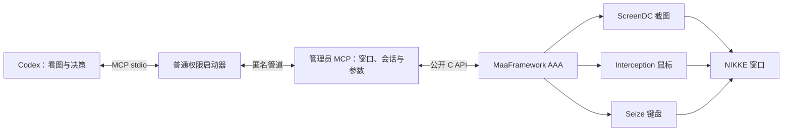

# NIKKE MCP 控制工具设计

> 2026-11-06：本文保留 2026-11-05 的 MCP 设计与验收历史。用户反馈每个新聊天都会自动启动 MCP 并请求 UAC，现已改用按需启动的 CLI + skill，项目 MCP 配置设为 `enabled = false`。当前用法见 [NIKKE CLI 控制工具](../../nikke-control.md)；CLI 复用 AAA 控制和匿名管道提权底层，无需 MCP SDK 或 uv，仅显式启动操作会话时申请权限。原有 MCP 入口保留为兼容实现。

日期：2026-11-05。状态：控制工具、仅提升 MCP 权限的启动器与项目级配置已完成，Python 3.12、3.13 下均有 44 项测试通过。真实 UAC 授权后，常驻会话连续三次从后台激活 NIKKE 并返回 1280×720 截图；Codex 保持普通权限。点击、拖动和单键的实际游戏响应仍按用户安排留待后续验收。

## 目标与已确认的选择

用户已选择通过 MCP 接入 Codex。工具负责连接 NIKKE 窗口、截图和发送基本输入，Codex 负责看图、决定下一步并确认页面变化。

控制配置与项目现有 AAA 一致：`ScreenDC` 截图、`Interception` 鼠标、`Seize` 键盘。首版提供点击、拖动和单键按下后释放。工具独立运行，使用本机已有的 MaaFramework，不需要启动 MXU、Go Agent 或加载游戏任务 Pipeline。

成功标准是 Codex 能通过 MCP 取得游戏截图，并用驱动鼠标完成一次可观察的页面操作。框架返回动作成功，只代表输入请求执行完成；游戏是否响应由后续截图确认。

## 方案选择

| 方案 | 成本与行为 | 结论 |
| --- | --- | --- |
| 修改内置 computer-use 插件 | 当前公开接口没有选择 Interception 的参数；修改插件内部实现还会受插件更新影响 | 使用独立工具接口 |
| 每次执行一条命令行命令 | 依赖少，但每次需要重新连接，截图与输入之间的会话状态需要另行保存 | 用户已选择 MCP |
| 本地 MCP 服务复用 AAA | 单个进程保持窗口、控制器和最近截图，可直接返回图片 | 采用此方案 |



MCP 使用 stdio，由客户端启动子进程，不监听网络端口。一个服务进程只维护一个控制会话，所有窗口、控制器操作串行执行。

## 运行方式与文件范围

采用 Python 标准库 `ctypes` 调用 MaaFramework/MaaToolkit，MCP 协议使用官方 Python SDK。脚本通过 PEP 723 内联声明依赖，固定 `mcp==2.3.0`；已在 Python 3.12、3.13 下验证。

启动命令：

```powershell
uv run --script E:\Git\MDA\tools\nikke_mcp_launcher.py
```

`uv` 为脚本维护独立依赖环境，不修改项目根目录的 Python 依赖。按用户要求，`nikke-control` 使用项目根目录的 `.codex/config.toml`，其中保留本机 uv 的绝对路径和上述脚本参数，用户级的同名注册已移除。已通过 `codex mcp get nikke-control --json` 确认在项目内启用，项目级作用域也已验证。当前聊天已发现八个工具，但旧控制进程仍为普通权限；需要重新加载 MCP，才能采用新的启动器并完成 UAC 授权。

实现文件：

| 路径 | 职责 |
| --- | --- |
| `.codex/config.toml` | 仅供当前可信项目加载的 MCP 配置，包含本机 uv 与脚本路径 |
| `tools/nikke_control.py` | DLL 绑定、窗口与控制会话、MCP 工具入口；依赖库在入口延迟导入，便于离线测试 |
| `tools/nikke_mcp_launcher.py` | 请求 UAC，仅提升控制进程，通过匿名管道转接 stdio 并管理句柄 |
| `tools/verify/test_nikke_control.py` | 参数、会话、坐标契约、异常结果与协议相关回归 |
| `tools/verify/test_nikke_mcp_launcher.py` | 二进制转接、部分写入、EOF、启动失败、模拟 UAC 取消与实际句柄复制回归 |
| `docs/nikke-control.md` | 启动、MCP 注册、调用示例和实际环境问题处理 |
| `.cache/nikke-control/` | 框架运行日志，使用现有忽略规则 |

运行时路径由脚本位置解析，优先使用仓库 `deps/bin`，缺失时使用 `install/maafw`；允许启动参数 `--maa-dir` 显式指定包含 DLL 的目录。同一次运行的框架与控制单元必须来自同一个目录。

初始化时检查所需导出函数和框架版本。MaaFramework 的控制台日志关闭，Python 日志写 stderr，框架文件日志写缓存目录，避免污染 MCP 的 stdout。

## 工具接口

| 工具 | 输入 | 结果与行为 |
| --- | --- | --- |
| `nikke_status` | 无 | 返回 DLL/版本、驱动可访问性、MCP 与游戏权限、实时窗口焦点和原生连接状态；不发送游戏输入 |
| `nikke_list_windows` | 无 | 返回符合 NIKKE 窗口特征的候选窗口，包含窗口标识、标题和进程标识 |
| `nikke_connect` | 可选 `window_id` | 无参数时只在候选唯一时连接；多个候选时要求指定；连接后返回首张截图 |
| `nikke_observe` | 无 | 恢复并激活已连接窗口，截图并返回新的 `snapshot_id` |
| `nikke_click` | `snapshot_id, x, y, button="left"` | 支持左、右、中键；执行一次点击并返回操作后的截图 |
| `nikke_drag` | `snapshot_id, from_x, from_y, to_x, to_y, duration_ms=500` | 执行一次拖动并返回截图；持续时间限制在 1～5000 毫秒 |
| `nikke_press_key` | `snapshot_id, key` | 接受字母、数字、空格、回车、Esc、Tab 和方向键等约定名称；单键按下后释放，返回截图 |
| `nikke_disconnect` | 无 | 释放控制器、恢复框架置顶等状态；重复调用可安全返回 |

首版不开放独立的鼠标/键盘按下与释放接口，避免跨调用保留按住状态。需要持续输入、组合键、滚轮或文本输入时，再根据实际游戏需求补充。

### 截图返回格式

图片通过 MCP 图片内容直接返回，同时提供结构化元数据。元数据示例：

```json
{
  "snapshot_id": "opaque-id",
  "window_id": "0x123456",
  "width": 1280,
  "height": 720,
  "raw_width": 1920,
  "raw_height": 1080,
  "captured_at": "2026-11-05T12:00:00+08:00"
}
```

窗口标识和截图标识采用字符串，图片不再嵌套进 JSON 字段。正常调用不把截图逐张写入磁盘。

## 坐标与窗口约束

截图由框架等比缩放，长边设为 1280。16:9 横屏对应 1280×720，其他比例以返回的实际 `width`、`height` 为准，不拉伸图片。

所有坐标都相对于返回截图的左上角。工具将这些坐标直接交给同一 MaaController，由框架完成截图坐标到原始窗口坐标的转换，不再次手动乘缩放比例。这样避免 DPI、窗口边框和重复缩放导致的偏移。

窗口通过 MaaToolkit 公开接口枚举，筛选条件沿用项目 AAA：类名 `UnityWndClass`，标题匹配 `(NIKKE|勝利女神：妮姬)`。连接时记录窗口句柄和进程标识，输入前确认仍是该窗口。

每次输入前检查：

1. `snapshot_id` 是当前会话最新且尚未消费的截图标识。
2. 坐标处于该截图范围内；不把越界值自动夹到窗口边缘。
3. 绑定窗口仍存在、可见且为前台，客户区位置与尺寸和截图时一致。
4. 鼠标目标位置实际命中游戏窗口或其子窗口；拒绝被其他窗口遮挡或屏幕外的目标。拖动检查起点和终点。

检查未通过时不发送输入，要求重新观察或连接。输入操作本身不在窗口失焦后直接抢回焦点并继续旧动作；`nikke_observe` 负责激活窗口并重新提供画面。

截图标识在输入提交时即失效，操作后的新截图产生新标识。重新连接、窗口销毁、位置/尺寸变化也会使旧标识失效。标识只约束会话与坐标来源，无法冻结游戏动画或阻止用户手动改变页面。

## 动作结果与失败处理

每个输入返回动作状态以及后续观察状态：

| 状态 | 含义 | 后续行为 |
| --- | --- | --- |
| `not_sent` | 参数、截图或窗口检查未通过，尚未提交输入 | 修正参数或重新观察 |
| `completed` | 框架报告输入请求完成 | 检查返回截图，判断游戏是否响应 |
| `unknown` | 提交后失败或超时，无法确定游戏收到多少输入 | 停止继续输入，不自动重试；等待底层请求结束后重新观察 |

如果输入已完成但后续截图失败，保留 `completed`，单独返回观察失败；不能把这种情况报告成“点击未执行”。截图失败、游戏无响应都不触发自动补点。

使用框架的异步动作状态检查设置 10 秒等待上限。超时仅表示结果未知，不宣称已取消；旧请求仍在运行时不接受新的输入或强制销毁。点击和单键动作由框架完成按下与释放，正常断开或服务退出时尝试通过 `MaaControllerPostInactive` 清理控制器状态，再销毁空闲控制器；外部强制结束进程时无法保证完整清理。

框架动作完成后的截图可能处于动画中，工具不把它解释为页面已稳定。Codex 根据图片决定是否继续观察。

## 权限与本机证据

截至 2026-11-05，已做的无输入检查如下：

- 本机 Interception 鼠标、键盘驱动已运行，文件产品名为 Interception。
- `deps/bin` 中 MaaFramework v5.13.1 能加载，控制器、截图、点击、拖动、按键和窗口枚举所需接口已找到。
- 当前执行进程不是管理员，但可以打开 `interception00` 和 `interception10` 设备句柄，检查后已关闭；未发送输入事件。
- 初次实机诊断通过进程令牌确认 NIKKE 已提权，原 MCP 与 Codex 未提权。AAA 在项目配置中还设置了 `permission_required: true`；驱动可访问不能代替窗口操作所需的权限。新启动器通过真实 UAC 验收，控制进程已提权；另行核对了 Codex 桌面进程的安装路径与令牌，确认它仍为普通权限。
- 本机存在 Python 3.13 和支持 `uv run --script` 的 uv；脚本依赖固定为 MCP SDK 2.3.0。

核心控制脚本按实际操作结果判断权限，不以“当前非管理员”直接拒绝；项目默认使用用户已选择的 UAC 启动器。激活失败时会检查 MCP 与游戏的提权状态；若已确认权限不同，错误中提示使用该启动器并授权。`nikke_status` 的 `is_admin`、`target_elevated` 和实时 `window.foreground` 分别描述三个独立条件；`connected` 仍是原生控制器连接状态。无法查询提权状态时返回 `null`，不把未知状态当作普通权限。键盘沿用 `Seize`，也不能据此声称键盘走驱动或不受目标进程权限影响。

统一权限仍不足以保证 Windows 允许常驻进程切换前台。连接和观察先尝试直接激活；失败时确保调用线程已有消息队列，临时关联前台与目标线程的输入队列，调整窗口层级并再次激活。所有成功的关联在 `finally` 中逆序解除，随后检查游戏实际已处于可见前台。只关联前台队列的早期尝试无效，最终采用同时关联两组队列的实现。

这是前台控制工具，运行时游戏需要处于可见、可操作状态。同一个游戏窗口由本工具操作期间，不应同时运行 MDA 自动任务。

### 仅提升 MCP 权限的启动器

用户在实机诊断后选择增加专用提权启动器，Codex 保持原有权限。项目配置改为启动 `tools/nikke_mcp_launcher.py`；启动器通过 Windows UAC 启动同一 Python 环境中的控制进程。已经提权时直接运行控制服务。

普通权限启动器创建两条匿名管道，把工作端句柄和自己的进程标识传给提权进程。提权进程通过 `DuplicateHandle` 取得这些句柄并接入标准输入/输出；启动器只转接字节，MCP 工具与截图协议沿用现有实现。此方案不监听网络端口，不创建可供外部连接的命名管道。日志写 stderr 和本项目缓存目录，不进入协议 stdout。

实现与验证结果：

1. 管道转接、部分写入、EOF、启动失败与句柄释放通过回归；UAC 取消为模拟测试，真实授权启动已通过。
2. 项目配置已指向启动器，启动等待设为 120 秒；控制进程启动后的握手等待为 30 秒，取消授权会明确报错且不自动重试。
3. 使用配置中的完整命令进行官方 MCP SDK 实测：普通权限调用进程启动管理员控制进程，`nikke_connect` 和两次 `nikke_observe` 均从后台激活并返回截图。断开和 EOF 清理后，控制进程已退出。真实游戏点击、拖动和按键仍单独验收。

## 实施与验收记录

截至 2026-11-05：

| 项目 | 状态与证据 |
| --- | --- |
| 控制器与会话 | 已完成；模拟后端检查 AAA 参数、窗口选择与身份、实时焦点与提权状态、激活失败后的连接/截图状态、位置变化、遮挡、坐标转发、截图消费、并发重放、结果分类及资源释放 |
| MCP 协议与图片 | 已完成；官方 SDK 客户端发现八个工具，模拟 PNG 通过 MCP 图片内容返回，图片尺寸与结构化元数据一致；非整数坐标被拒绝 |
| 本机 DLL 与 stdio | 已完成；实际 Windows 子进程可加载 MaaFramework v5.13.1，完成工具发现、状态查询、窗口枚举和未连接错误检查，无 stdout 协议污染；未发送真实输入 |
| Codex 注册与说明 | 已完成；项目级配置启用，全局同名注册已移除，检查确认项目内可发现、项目外不可发现，其余用户配置未变。此前使用同一 uv 启动命令从系统临时目录通过了只读 MCP 检查；使用说明见 [NIKKE MCP 控制工具](../../nikke-control.md) |
| 权限与前台激活 | 已定位权限差异和前台锁定两个原因。跨权限失败提示、实时状态、同时关联两组队列及异常清理均有回归；真实提权会话连续三次后台激活成功，并返回 1280×720 游戏截图 |
| 提权启动器 | 已完成真实 UAC 启动、八个工具发现、图片协议转接、断开与 EOF 清理，日志确认控制进程启动后退出。Codex 桌面进程令牌仍未提权；UAC 取消只做了模拟验证 |
| 待验收 | 真实点击、拖动和单键响应仍按用户之前的安排留待之后，本次未调用这些游戏输入工具 |

完整行为与协议测试在 Python 3.12、3.13 下均为 **44 项通过**，包括权限与激活回归、匿名管道转接和实际 Windows 句柄复制。测试命令：

```powershell
uv run --no-project --with 'mcp==2.3.0' python -m unittest tools.verify.test_nikke_control tools.verify.test_nikke_mcp_launcher -q
```

真实提权验收记录保存在本机 `.cache/nikke-control/elevated-validation.json`，截图为 `.cache/nikke-control/elevated-activation-check.png`，控制进程日志为 `.cache/nikke-control/elevated-stderr.log`；缓存文件不纳入版本管理。

后续重新加载客户端 MCP，采用新启动器并授权，再按用户安排选择无需消耗资源的页面操作，分别验证点击、拖动和单键响应；移动或缩放窗口后，确认旧截图被拒绝，重新观察后仍能正确落点。当前已验证持续激活与截图，“输入能被 NIKKE 接受”仍保留为未验证。

## 依据

- [现有 AAA 控制器](../../../assets/interface.json)：截图、鼠标、键盘设置和窗口筛选条件。
- [本地控制器 C API](../../../deps/include/MaaFramework/Instance/MaaController.h)、[窗口枚举 C API](../../../deps/include/MaaToolkit/DesktopWindow/MaaToolkitDesktopWindow.h)：实际调用边界。
- [MaaFramework v5.13.1 坐标处理源码](https://github.com/MaaXYZ/MaaFramework/blob/v5.13.1/source/MaaFramework/Controller/ControllerAgent.cpp)：框架将缩放截图坐标转换为原始输入坐标。
- [MaaFramework v5.13.1 Interception 实现](https://github.com/MaaXYZ/MaaFramework/blob/v5.13.1/source/MaaWin32ControlUnit/Input/InterceptionInput.cpp)：驱动设备访问方式。
- [MCP 官方 Python SDK](https://github.com/modelcontextprotocol/python-sdk)、[PyPI 发布元数据](https://pypi.org/pypi/mcp/json)：协议实现和依赖版本来源。
