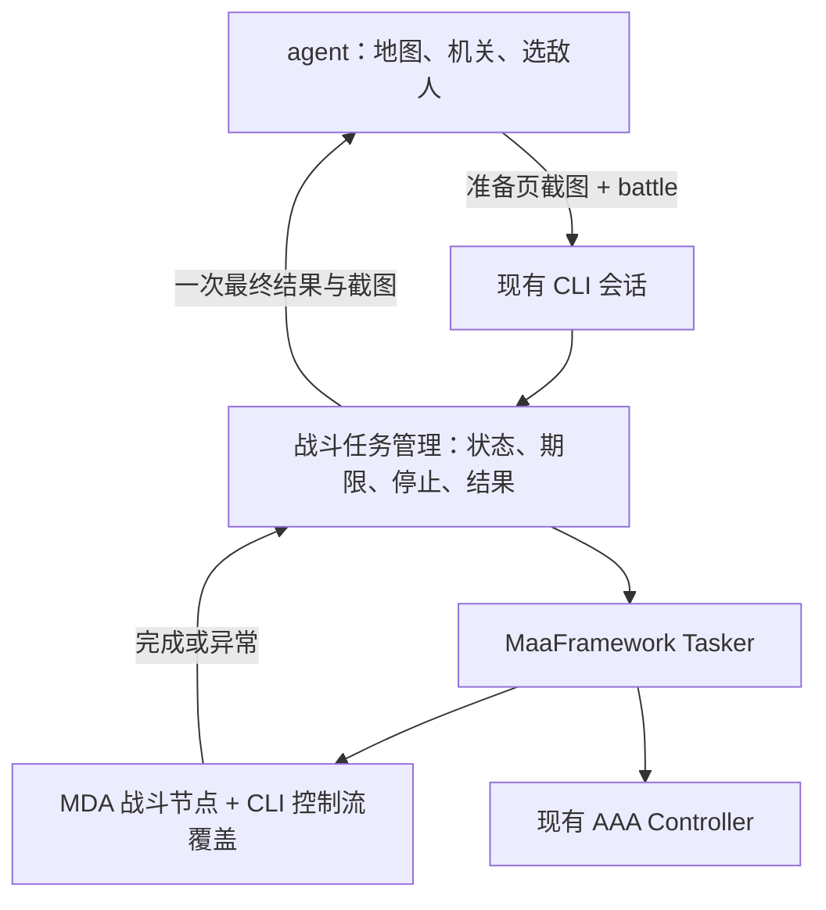

# NIKKE CLI 与 MDA 战斗流程融合设计

日期：2026-11-06。状态：异步执行、CLI 接口与 skill 已实现；正向胜利识别和游戏实机验收尚未完成。

## 实现与证据边界

`tools/nikke_battle.py` 和 `tools/nikke_resources/pipeline/CampaignBattle.json` 已接入现有 CLI，支持 `battle`、`stop`、异步完成事件、资源延迟加载及连接内复用。项目 control skill 和用户级 campaign skill 已切换到准备页显式托管。

本机 MaaFramework v5.13.1 的真实 DLL 加虚拟控制器已验证快战、普通自动战斗、战败返回、奖励遮挡、章节交还、多次战斗阻断、珠宝确认阻断、自动开关保持、任务覆盖隔离、原生停止及 Controller 队列排空。叶子识别和动作采用探针，不能替代 OCR、落点和游戏验收。一次虚拟连接的首次资源加载约 0.95 秒；未测实机内存与稳定性能。

当前没有真实胜利、快战成功和完整奖励/升级遮挡样本。实现保守返回 `lost` / `unknown` / `not_started`，**不产生 `won`**；成功结束并回图也保留 `unknown`，由 agent 查看最终图确认清敌进度。下文的明确胜利证据仍是待完成要求；没有编造文案、ROI 或阈值。

复合识别引用经实测不会继承被引用节点的 `inverse`。地图交还改为先确认地图，再按 `next` 顺序优先拦截已知遮挡，最后命中交还节点，避免依赖无效的负向复合判断。

## 目标与首版边界

在现有按需启动的 CLI 会话中增加战斗托管：agent 负责主线地图导航和选择敌人，进入战斗准备页后调用一次 `battle`，本地 MaaFramework 执行进入战斗、自动战斗和结算，结束时返回结果与截图。

接管由 skill 在准备页显式调用 `battle` 触发。仅打开关卡查看信息或调整阵容时，控制权仍由 agent 保持，不自动开战。

首版按以下假设设计，后续实现不得把这些假设当成用户对所有任务的长期授权：

- 场景为 Normal / Hard 主线清怪；EX 继续由 campaign skill 判断并跳过。
- 以一次遭遇为单位，保留当前编队，优先免费快速战斗；不自动选择下一关、多次战斗 MAX、购买次数或失败重试。
- 沿用清怪任务默认跳剧情的策略。用户明确要求阅读剧情时，首版不启用这段完整托管，继续由 skill 按当前方式处理；剧情暂停与恢复不纳入首版。
- 正常交还点为已确认的主线地图；章节切换提示属于另一个明确交还点，由 agent 决定是否继续章节。
- 不改变 MCP 禁用状态，不在新聊天、技能加载或只读检查时创建战斗资源或申请 UAC。

成功标准：一次接管可完成快速战斗或普通自动战斗并交还控制；胜败有独立证据，返回场景可解释；异常能停止或明确报告仍在停止；战斗期间不需要 agent 反复调用 `observe` 或处理固定按钮。

## 设计前核实的现状

| 现有部分 | 证据与融合影响 |
| --- | --- |
| CLI 会话 | `tools/nikke_cli.py` 已有长驻于一次操作期间的 JSON 行会话；当前逐条同步执行命令，没有后台任务与完成事件。 |
| 控制底层 | `tools/nikke_control.py` 持有 AAA Controller、单次截图标识和输入锁，目前没有 Resource / Tasker。原生输入请求等待上限为 10 秒，不能直接当成战斗任务超时。 |
| 战斗入口 | `assets/resource/pipeline/Battle/Battle.json` 的 `BattleEntryFlow` 会进入角色选择，快速战斗流程还包含多次战斗分支。 |
| 战斗过程 | `BattleInBattleFlow` 已处理自动瞄准、自动爆裂、Boss 动画、剧情与结算，但包含 `BattleClickNextStage` 和章节区域变化处理。 |
| 结算证据 | `BattleConfirmOperationComplete` 当前复用 `BattleSettlementEscVisible`，识别的是 ESC；`CommonEndTask` 是空结束节点。这两者都不能单独证明获胜或返回地图。 |
| 失败证据 | `BattleFailedVisible` 明确识别战败 / 逾时，可复用，但仍需验证结算页与成功识别不会交叉误命中。 |
| 地图证据 | `MapPushingMinimapVisible` 和 `MapPushingOpenMinimap` 可作为展开 / 收起地图的识别来源；地图标志可能在弹窗背后可见，不能单独当成清理完成。 |

本次在普通权限下对本机 MaaFramework **v5.13.1** 做了只读探测：Resource / Tasker 所需导出函数存在，`assets/resource` 可通过 `MaaResourcePostBundle` 加载成功；没有创建 Controller、申请 UAC 或发送游戏输入。这证明基本接入路径可用，不代表战斗流程已经验收。

接口依据为 `deps/include/MaaFramework/Instance/MaaTasker.h`、`MaaResource.h`，以及现有真实框架回放工具 `tools/verify/verify_map_pushing_minimap.py`、`verify_scene_navigation.py`。事件 payload 的实际结构以当前 DLL 回放结果为准，不能只照抄头文件示例。

## 融合结构



沿用同一个提权控制进程和同一个 Controller，不再启动 MXU、第二个控制程序或第二次 UAC。Python 管理任务和解释结果，所有模板、OCR、颜色、ROI、点击目标和页面识别仍写在 Pipeline。

首次 `battle` 才创建 Resource 和 Tasker：加载现有 `assets/resource`，再加载 CLI 专用的少量入口与终止节点，将 Tasker 绑定到当前 Controller。首版直接复用完整资源目录，避免维护一份复制的最小战斗资源包；实际首次耗时与内存应在实现时记录，不能把本次一次加载成功当作性能基准。

Resource / Tasker 在当前连接内复用。断开或换窗口时，在任务确实停止后按 Tasker → Resource → Controller 的顺序释放。普通 `status`、`windows`、手动截图和点击不触发战斗资源初始化。

## 战斗 Pipeline 如何复用

新增 `tools/nikke_resources/pipeline/CampaignBattle.json`，只声明 CLI 专用的状态检查、结果标记和交还边界。已有模板、识别与动作参数继续来自 MDA 原节点。

通过 `MaaTaskerPostTask` 的 `pipeline_override` 参数为本次任务覆盖控制流；不改共享 `Battle.json` 的默认行为，也不执行包含自动寻敌与 Go 自定义组件的 `MapPushingFlow`。实现时验证覆盖不会污染后续任务和原 Resource。

不全局重定义 `CommonEndTask`：它在 `[JumpBack]` 子流程中也承担正常返回。只调整 CLI 顶层的完成 / 失败出口，以专用终点判断本次托管结果。

| 环节 | 复用与覆盖方式 |
| --- | --- |
| 准备页 | 复用 `BattleMainVisible` 和模式说明关闭识别；禁用角色选择路径。非准备页拒绝启动，返回 `not_sent`。 |
| 快速战斗 | 复用快速战斗可见 / 可用识别与点击；去掉多次战斗选择与 MAX 路由。出现不属于单次主线快战的界面就交还。 |
| 普通战斗 | 复用进入战斗、加载后状态识别和自动瞄准 / 爆裂，只在关闭状态被识别时开启。 |
| 剧情 / Boss | 复用现有清怪跳剧情、确认和 Boss 动画处理。 |
| 结算 | 复用结算按钮动作和明确战败证据；胜利证据待实图补充，目前返回 `unknown`。先记录结果，再清理界面；ESC 只用来定位结算操作。 |
| 返回地图 | 增加有界清理与地图确认；识别展开或收起的小地图，并确认已知遮挡弹窗已结束。未满足不能宣称回图。 |
| 下一关 / 章节 | 移除 `BattleClickNextStage`；章节切换提示作为终止交还点，不自动确认并继续下一章。 |
| 不可战斗 / 未知界面 | 进入明确的受阻终点，保留截图；不把通用 `CommonEndTask` 回退视为业务成功。 |

已实现的结果/边界节点包括 `NikkeCampaignBattleLost`、`NikkeCampaignBattleMapReturned`、`NikkeCampaignBattleChapterTransition` 和 `NikkeCampaignBattleBlocked`。没有声明缺乏识别证据的胜利节点。

胜利文案、快速战斗结果和奖励 / 升级弹窗需用实际画面确定；本次没有采集这些样本，不预设 OCR 文本或阈值。先得到胜败证据，再做后续点击，防止结算被关闭后失去可解释的结果。

## CLI 接口与事件

在现有交互会话内增加：

```text
battle --snapshot <最新截图标识>
status
stop
```

JSON 等价入口为 `{"op":"battle","snapshot_id":"..."}` 和 `{"op":"stop"}`。不向 agent 开放任意 Pipeline 入口或任意覆盖 JSON。

`battle` 异步启动，立即返回带 `battle_id` 的受理结果。后台任务结束后输出一条 `battle.finished` 事件。每次会话至多有一个战斗任务；`battle_id` 用于区分结果与历史事件，不新增跨进程服务。

```json
{"type":"response","op":"battle","ok":true,"battle_id":"b1","status":"running","phase":"preparing"}
```

正常结束示例：

```json
{
  "type": "battle.finished",
  "battle_id": "b1",
  "ok": true,
  "status": "completed",
  "outcome": "unknown",
  "return_state": "campaign_map",
  "controller_idle": true,
  "input_status": "completed",
  "observation_status": "completed",
  "snapshot_id": "新的截图标识",
  "image_path": "E:/Git/MDA/.cache/nikke-control/cli/会话标识/latest.png"
}
```

| 字段 | 语义 |
| --- | --- |
| `status` | 最终为 `completed`、`blocked`、`timed_out`、`cancelled` 或 `failed`；运行中另有 `running` / `stopping`。 |
| `outcome` | 目前为 `lost`、`unknown`、`not_started`，`won` 留待正向识别验证后启用。只按当前任务明确命中的结果节点设置；Tasker 成功、ESC 或地图出现都不能推导 `won`。 |
| `return_state` | `campaign_map`、`chapter_transition`、`preparation`、`combat`、`story`、`result` 或 `unknown`，表示最后确认的页面。 |
| `controller_idle` | 只有任务已停止、Tasker 不再运行且控制器请求已排空，才能为 `true`。 |
| `input_status` | 保留现有约定：未交给 Tasker 时为 `not_sent`；执行异常、停止或超时时保守报告 `unknown`，不能表示“整场输入没有发生”。 |
| `observation_status` | 最终取图 / 落盘是否成功，与战斗结果分别记录。图片失败不把已确认胜利改成失败。 |

最终事件的 `ok` 表示托管流程和交还检查是否正常完成，不表示获胜。因此战败后正常返回地图可为 `ok: true, outcome: lost`；胜利已确认但回图受阻则为 `ok: false, outcome: won, status: blocked`。agent 必须分别读取这些字段。

`status` 增加当前战斗的 ID、阶段、Tasker 运行状态和最近结果，立即返回且不截图。`stop` 只请求停止当前任务，先回复 `stopping`；真正停止后才发送最终事件。完成事件发出前，不能把停止请求受理当成控制器已空闲。

## 并发、截图与停止

当前 CLI 在读取一行后同步执行，不能直接把三分钟战斗放进现有命令锁，否则 `stop` 和 `status` 会被堵住。增加一个战斗执行线程，stdin 继续读命令；所有 JSON 输出通过同一写锁串行化，防止回复与完成事件拼接成无效 JSON。

Controller 所有权明确为 `manual`、`battle`、`stopping`：

1. 受理时快速确认连接、最新截图、窗口和原生请求空闲；原子地消费一次 `snapshot_id`，保留观察时的窗口信息，并将所有权交给战斗任务。
2. 执行线程按需准备资源，再重新检查窗口和实际准备页后提交 Tasker。资源加载也必须有界且支持登记停止意图；准备阶段取消或失败不提交战斗输入，报告 `not_sent`。重复 `battle` 拒绝，不排队，初始化期间也不长时间持有命令锁。
3. 战斗中拒绝手动点击、拖动、按键、重新连接和 `observe`，只允许 `status`、`stop`。Tasker 内部自己截图，agent 不参与循环。
4. 结果与原生停止都确认后，保持独占完成一次最终截图，再生成新的 `snapshot_id`，交回手动所有权。
5. 异常停止尚未完成时保持 `stopping`，没有可供下一次输入的有效截图；后续 `status` 继续反映真实状态。

Tasker 的任务 ID / 停止 ID 单独保存，不写入现有用 `MaaControllerStatus` 查询的 `pending_id`。事件回调只记录当前任务的节点与阶段，并保留 ctypes 回调引用到 Tasker 销毁；回调中不等待、不截图、不打印整段日志。结果可结合 `MaaTaskerGetTaskDetail` / `MaaTaskerGetNodeDetail` 核实，不能引用上一场任务的缓存节点。

沿用 MDA 已有阶段等待（普通进入最多 60 秒，战斗流程 210 秒），另加建议为 300 秒的单次执行总期限，避免节点循环刷新阶段超时。具体总期限是待实测的首版默认值，不沿用手动输入的 10 秒限制。超时请求 `MaaTaskerPostStop`，等待实际停止；停止等待也有上限，未停稳则报告 `stopping` / `stop_pending`，不释放控制器或开始下一场。

停止等待达到上限时，主动输出一次 `battle.stopping` 异常事件，带 `reason: stop_pending` 和 `controller_idle: false`；这不是完成事件。后台继续收尾，停稳后才发 `battle.finished`。期间不排队抓图，不反复输出相同状态，避免让 agent 无期限等待却不知道发生了什么。准备阶段的 Resource 加载也需等到其原生请求结束后才能销毁。

`quit` 遇到战斗运行或停止中时提示先 `stop`，不会销毁仍被使用的 Controller。EOF / 会话退出也执行停止与清理；无法及时停稳时记录诊断并保持资源隔离，不能伪造 `session: closed`。强制杀进程仍不保证完成原生清理。

## 前台与输入保护的实际限制

Tasker 会直接驱动 Controller，绕过当前每次手动输入前的 `_validate`。因此接入必须补充本地的窗口身份、前台、可见性与几何监测，失焦或窗口变化时请求停止，不在战斗中自动抢回焦点继续旧步骤。

该监测与停止不能撤回已经在执行或排队的原生输入；发现变化时应报告输入可能已部分发生，并在停稳后重新观察。不能将事件回调视为原子输入拦截器，也不能承诺“发出 stop 后绝不会再落下一次输入”。若实测保护无法满足 AAA 的前台输入要求，必须先解决这一边界，不能仅凭任务状态成功就开启实机托管。

## skill 的使用方式

`nikke-control` 增加 battle 的调用、事件等待、停止和结果解释。`nikke-campaign` 保留地形、机关、EX、章节边界和选敌决策；到达准备页后优先交给 battle，不再自己逐步处理固定战斗按钮。

agent 发送命令后等待同一终端的完成事件即可，必要的终端等待不包含截图推理或战斗决策。中间阶段与重复识别写本地日志，stdout 只保留受理、显式状态查询、需要介入的异常通知和最终结果。正常结束只需查看最终截图，确认地图与敌人变化后继续导航；失败、受阻或超时再介入。

CLI 接口和两个 skill 已同步实现。首版明确说明 `unknown` 的证据限制，要求查看最终地图确认敌人变化，不能因结果未知就重复战斗。

## 实施顺序与验证

实现按以下顺序推进；第 1 项缺失的真实样本和第 6 项实机验收仍待后续游戏操作时补齐。其余执行流程已有行为测试和真实框架虚拟回放。

| 阶段 | 拟涉及文件 | 完成与验证标准 |
| --- | --- | --- |
| 1. 固定识别证据 | 战斗 / 结算 / 回图截图与新 overlay 的识别节点 | 收集快战成功、普通成功、失败、奖励遮挡和章节提示样本；验证 ESC 不等于胜利，地图背后的标志不误判交还。所有坐标与识别参数放 Pipeline。 |
| 2. 复用执行引擎 | 新增 `tools/nikke_battle.py`；接入 `tools/nikke_control.py` | 延迟加载 Resource / Tasker 并绑定同一 Controller；使用虚拟控制器验证资源、任务覆盖、事件解析和回收，不连接游戏。 |
| 3. 单次战斗图 | 新增 `tools/nikke_resources/pipeline/CampaignBattle.json` | 快战与普通战斗均到达结果和交还终点；不触发换角色、MAX、下一关或自动重试；用当前 Pipeline schema 与框架离线回放验证，原 MDA 默认图保持不变。 |
| 4. 会话与控制权 | `tools/nikke_cli.py`、`tools/nikke_control.py`；新增 `tools/verify/test_nikke_battle.py` | battle 异步受理，status / stop 可及时响应；忙时手动输入拒绝；旧截图、重复提交、输出交错、超时未停稳和退出清理均有行为回归。 |
| 5. skill 与文档 | 项目 `nikke-control`、用户级 `nikke-campaign`、`docs/nikke-control.md` | 更新为真实接口；用模拟任务跑通“agent 选敌 → battle → 最终截图 → agent 继续”，运行 skill 校验。 |
| 6. 实机验收 | 同一 CLI 会话与现有 AAA | 按用户后续实际操作安排，验收一次快战和一次普通战斗、停止与失焦、奖励后回图；记录首次加载 / 复用耗时及内存。新聊天仍不启动服务、不申请权限。 |

关键回归还包括：Tasker 返回成功但没有胜利证据；确认胜利后弹窗挡住地图；明确战败后回到地图；失焦时原生动作结果未知；Tasker 已结束但 Controller 仍有请求；最终截图保存失败；第二场复用资源却不能继承第一场结果。

已有 `tools/verify/verify_map_pushing_minimap.py` 和 `verify_scene_navigation.py` 可作为真实 MaaFramework + 虚拟控制器的回放基础。缺失的战斗样本是实现阶段的证据需求，不把未采集画面写成已验证规则。

2026-11-06 实施验证：Python 3.12 / MCP 2.3.0 的控制器、提权桥、CLI 和战斗回归共 78 项全部通过；`python -S -m tools.verify.verify_nikke_battle` 在 v5.13.1 下 13 组虚拟控制器回放通过；CLI Pipeline / interface schema 和两个 skill 校验通过。原 MDA 资源及 Go 文件没有改动，没有触发真实 UAC 或游戏输入。真实成功识别、完整弹窗覆盖、首次/复用内存和游戏实机验收仍未完成。
